<div align="center">



<p>
  
  
  
</p>

**Your own webhook inspector, running on localhost.**

</div>

---

## ✨ Features

- 🪝 Accepts **any method on any path** and answers `200` so senders are happy
- ⚡ **Live web UI** that updates every second
- 🧾 Shows headers, query string and body, with **pretty-printed JSON**
- 📋 **Copy as curl** to replay a request
- 🔧 Choose the response status and body to simulate failures
- 🔒 Binds to `127.0.0.1` by default

## 🚀 Usage

```bash
git clone https://github.com/CyberLoop-dev/hookcatch.git
cd hookcatch
python3 hookcatch.py
```

Open **http://127.0.0.1:8787/__ui**, then send something:

```bash
curl -X POST http://127.0.0.1:8787/stripe/events \
  -H "Content-Type: application/json" \
  -d '{"type":"invoice.paid","amount":4200}'
```

### Options

| Flag | Default | Meaning |
|---|---|---|
| `--port` | `8787` | Port to listen on |
| `--host` | `127.0.0.1` | Bind address (use `0.0.0.0` only on networks you trust) |
| `--status` | `200` | Status code returned to the sender |
| `--response` | `{"ok":true}` | Body returned to the sender |

## 🌍 Need a public URL?

Webhook providers cannot reach `localhost`. Put a tunnel in front, for example `cloudflared tunnel --url http://127.0.0.1:8787`, and give the provider the tunnel URL.

## 🔐 Notes

- Requests are kept **in memory** (last 200) and vanish when you stop the server.
- Captured webhooks can contain secrets. Do not expose the UI publicly.
- `/__ui`, `/__events` and `/__clear` are reserved paths.
- Bodies larger than 1 MB are truncated, and chunked uploads are not supported.

## 📄 License

MIT
